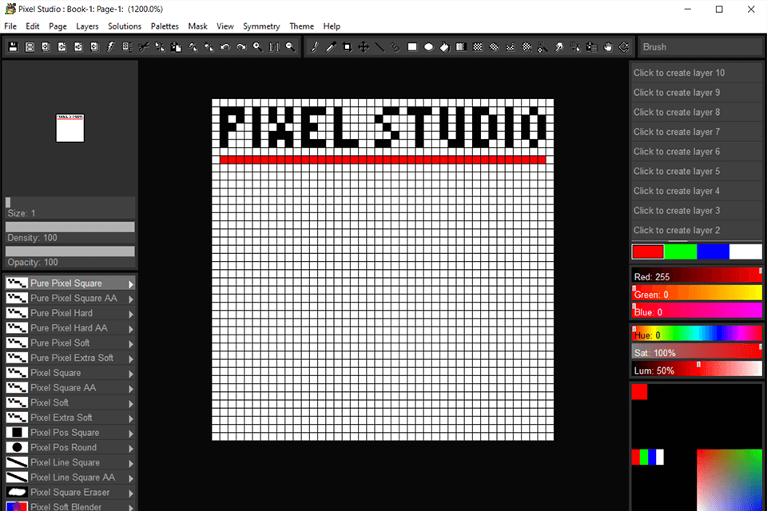
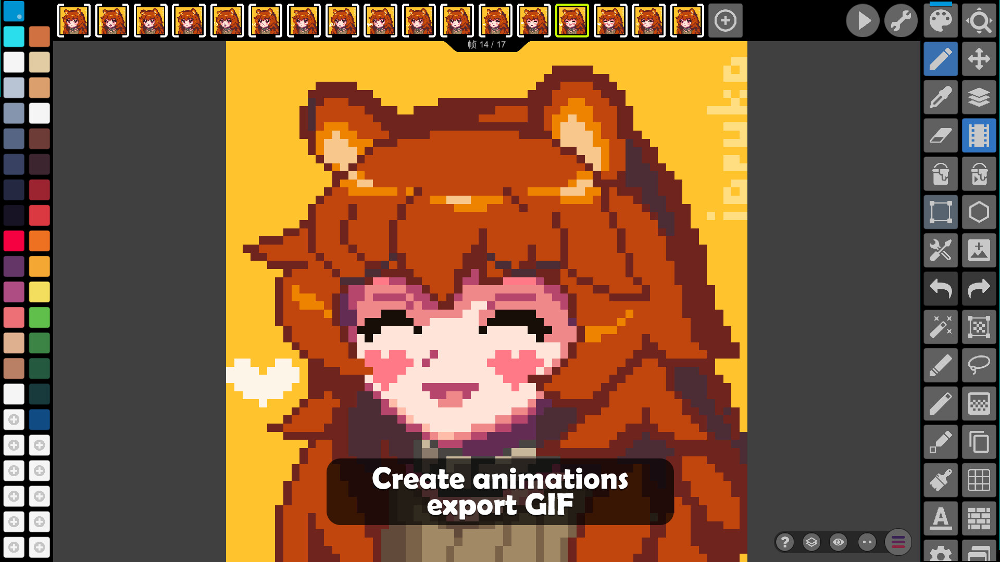
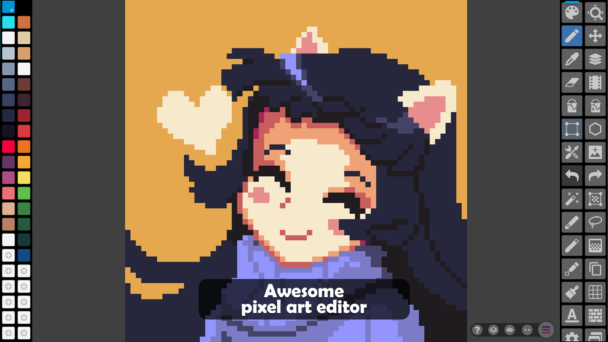

# Pixel Studio, From Pocket Sketch to Sprite

Pixel Studio by Hippo Games combines pixel drawing, layered projects, and animation across mobile and desktop workflows. Keep the editable artwork intact while moving between devices, then prepare an export that suits the game, animation preview, or collaborator receiving it.

## Move the project without flattening your work

Save an editable Pixel Studio Project before making a shareable image.
The PSP project format and a flattened PNG serve different purposes.
Give the project a recognizable name and keep a revision before a major change.

Pixel Studio supports Google Drive synchronization across devices.
The current iOS listing identifies Google Drive Sync as a PRO feature.
Check the edition and account on both devices before relying on a transfer.

### Finish the transfer before continuing the drawing

1. Save the current project on the source device.
2. Allow the chosen synchronization operation to finish.
3. Open the project on the destination device.
4. Compare its dimensions, layers, frames, and most recent edit.
5. Keep a separate revision before continuing on the second device.

Avoid editing two divergent copies simultaneously.
When a transfer looks incomplete, identify which copy contains the last confirmed changes before replacing anything.
Autosave and backups help recovery, but an opened and checked revision gives you a clearer handoff.

Piskel's [save-and-storage.md](docs/specs/save-and-storage.md) describes that editor's saving and recovery behavior.
Its [import.md](docs/specs/import.md) covers bringing existing artwork into a project.
[settings.md](docs/specs/settings.md) distinguishes preferences from document settings.
Use those distinctions as questions to ask during a transfer check.

[](https://pix-art-studio.github.io/Pixel-Studio/)

## Build the image from readable color clusters

Choose a working size that matches the final use.
A small game character needs a clear silhouette before it needs tiny highlights.
Block the largest shapes first, then test the image at its intended display size.

Pixel Studio provides layers, custom brushes, symmetry drawing, and color tools.
Its palette workflow includes custom palettes, built-in choices, and Lospec palettes.
Use a limited set while establishing the light direction and material colors.

### Let the palette explain the form

- Reserve a dark value for the outline or deepest shadow.
- Choose a base color that remains distinct from the background.
- Add a highlight only where it reinforces the lighting.
- Reuse an accent intentionally instead of adding a new shade for every detail.
- Check whether neighboring clusters merge when viewed at normal size.

RGBA and HSV controls describe different ways to choose a color.
Alpha affects opacity; changing brightness or saturation does not replace an opacity decision.
Preview translucent edges against both light and dark backgrounds.



### Keep the canvas comfortable on each device

Use the workspace layout that leaves enough room for the drawing.
On touch devices, verify the selected tool after gestures or toolbar changes.
On a desktop, keep frequent actions within easy reach without assuming another editor's shortcuts.

Piskel's [colors-and-palettes.md](docs/specs/colors-and-palettes.md) documents its color-selection model.
[drawing-tools.md](docs/specs/drawing-tools.md) covers its drawing tools, while [canvas.md](docs/specs/canvas.md) covers the drawing area.
Its [keyboard-shortcuts.md](docs/specs/keyboard-shortcuts.md) describes configurable keyboard access.
These references can help organize a tutorial around color, marks, navigation, and input.

## Make the tile convincing at its boundaries

For a repeating texture, inspect opposite edges together.
A rock, branch, or highlight cut by one side needs a deliberate continuation on the other.
Review the pattern at several repeats so a strong diagonal does not create an accidental stripe.

Pixel Studio includes a seamless texture tile mode.
The current iOS listing places that mode among PRO features.
Confirm its availability in the version used for the project.

### Review an exported tile as a small pattern

With ImageMagick 7 available, this command repeats one PNG in a two-by-two grid.
The zero-gap geometry places the copies directly beside each other.
Choose an unused output filename.

```sh
magick montage "tile.png" "tile.png" "tile.png" "tile.png" -tile 2x2 -geometry +0+0 -background none "tile-repeat-review.png"
```

Look along the center seams and at the four-way junction.
Then move your attention away from the seams and judge whether the repetition itself becomes distracting.
Keep the source tile separate from this review image.



### Transform a copy before committing the change

A flip, rotation, or resized selection can alter the rhythm of the pattern.
Keep an earlier revision so the original remains available for comparison.
Inspect the result at one-to-one pixel size after any transformation.

Piskel's [selection.md](docs/specs/selection.md) describes selecting regions for movement or reuse.
Its [transformations.md](docs/specs/transformations.md) covers transformation behavior.
[undo-redo.md](docs/specs/undo-redo.md) documents that editor's history model.
Treat selection scope, transformation scope, and recovery as separate checks.

## Make the movement read before polishing every frame

Start with the key poses that communicate the action.
Keep a consistent anchor, such as the feet on a shared ground line.
Use the preview to judge rhythm rather than judging motion only from individual drawings.

Pixel Studio supports frame-by-frame animation and onion skin.
Compare neighboring poses with onion skin, then watch playback without the extra references.
A clear transition often matters more than an additional decorative frame.

### Watch the layers as well as the timeline

Keep background references separate from moving details when that makes the animation easier to edit.
Check whether a change affects only the intended frame and layer.
Compare layer visibility and opacity in the saved export as well as in the editing view.

Piskel's [frames.md](docs/specs/frames.md) describes its timeline operations.
[layers.md](docs/specs/layers.md) explains its layer stack, and [preview.md](docs/specs/preview.md) covers playback and neighboring-frame display.
The note [clarify-layer-opacity-preference.md](TODO/clarify-layer-opacity-preference.md) discusses two opacity-related controls in Piskel.
It illustrates why a faint editing guide and reduced output opacity are different concepts.



### Give the loop an intentional return

Watch the transition from the final frame to the first.
Check small features such as eyes, buttons, and highlights for one-pixel flicker.
For a held pose, decide whether the pause contributes to the action.

Keep a note of frame order and timing with the project.
A sheet export carries pictures, while its consuming application may need separate timing information.
Confirm that the delivered preview matches the intended playback.

## Match the exported file to the next task

Keep the editable project even when the immediate request is a GIF or PNG.
Pixel Studio supports image exports, animated GIFs, and sprite sheets.
The iOS listing also describes MP4 output and Aseprite import, with some advanced exports requiring PRO.

| Delivery form | What the recipient receives | Detail to verify |
| --- | --- | --- |
| Pixel Studio Project | An editable project for continued work | Layers, frames, and the expected application version |
| PNG image | A still image or exported sheet | Dimensions, transparency, and any cell grid |
| GIF animation | A readily viewable animated preview | Timing, looping, palette changes, and transparent edges |
| Sprite sheet | Frames arranged into one image | Cell size, spacing, reading order, and anchor |
| MP4 video | A video preview, optionally with music where supported | Playback dimensions, duration, and audio |

An interchange format should be tested with the receiving application.
Open a representative export and compare it with the project before handing over a large collection.
Check the actual export controls on the installed platform instead of assuming identical options everywhere.

### Extract a first-pose thumbnail from a known sheet

This Python example uses Pillow to crop the first cell of a 256-by-32 PNG strip.
The strip must contain eight 32-by-32 cells without padding or gaps.
The output is created exclusively so an existing thumbnail is not replaced.

```python
from PIL import Image
with Image.open("walk-strip.png") as sheet:
    if sheet.size != (256, 32):
        raise ValueError("Expected eight 32-by-32 cells in one row")
    first_pose = sheet.crop((0, 0, 32, 32))
    with open("walk-first-pose.png", "xb") as output:
        first_pose.save(output, format="PNG")
```

The thumbnail is a still image; the sheet and its timing notes remain separate deliverables.
For another layout, change the crop rectangle to match the measured cell boundaries.
Do not infer a frame grid from image dimensions alone.

### Companion export references

Piskel's [export.md](docs/specs/export.md) describes its own format and scaling behavior.
The [sprite.js](scripts/sprite.js) script generates Piskel's interface sprite sheets and associated CSS.
[visual-storyboard.js](scripts/visual-storyboard.js) creates an HTML overview from visual-test screenshots.
Those materials show different uses of a sheet and a review page.

## Keep device details with any reproducible problem

For a Pixel Studio Pro workflow, record the platform, application version, and feature being used.
For Pixel Studio animation issues, include the relevant frame sequence and intended timing.
A short project that demonstrates the problem is more useful than an unexplained full collection.

The [official PixelStudioHub](https://github.com/hippogamesunity/PixelStudioHub) provides the developer's wiki and issue tracker.
It is a public support and resource hub rather than the full application's source tree.
Use the developer's guidance when checking purchases or cross-platform access.

### Read the reference collection with its scope in mind

Piskel's [editor.md](docs/specs/editor.md) describes general editor interactions.
The feature-spec [README.md](docs/specs/README.md) explains how its documented claims relate to testing.
[known-issues.md](docs/known-issues.md) records issues in that collection.
[fix-clock-going-backwards.md](TODO/fix-clock-going-backwards.md) discusses a Piskel timing problem involving the system clock.

Its [spec-check.js](scripts/spec-check.js) validates references between specifications and tests.
[untested.txt](docs/specs/untested.txt) records the specification claims without associated tests.
[playwright.config.ts](playwright.config.ts) configures browser integration and visual tests.
[karma.conf.js](karma.conf.js) configures the unit-test runner, and [global.d.ts](global.d.ts) declares a browser-global type.

### Separate packaging references from artwork exchange

Piskel's [desktop.js](scripts/desktop.js) packages its desktop application, while [serve.js](scripts/serve.js) serves its production build.
[partials.js](scripts/partials.js) prepares website integration variants.
Its [package.json](package.json) describes the project and scripts, and [package-lock.json](package-lock.json) records dependency resolution.
These packaging materials do not define Pixel Studio's project or export formats.

For current Pixel Studio features, consult the [Steam listing](https://store.steampowered.com/app/1204050/Pixel_Studio_pixel_art_editor/?l=english) and [iOS listing](https://apps.apple.com/us/app/pixel-studio-pixel-art-editor/id1404203859).

## Related Search Terms

Pix Art Studio, Pixel Studio, pixel studio pro, pixel studio for pixel art, pixel studio animation, pixel-art, sprites, sprite-animation, spritesheet, animation, graphics, pixel-editor, drawing, game-development, art
